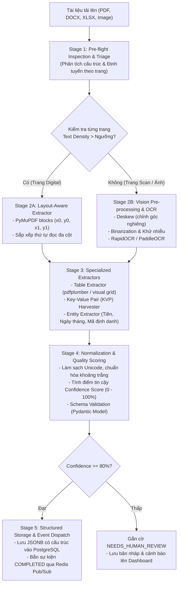

# Quy Trình Hoàn Chỉnh Xử Lý Tài Liệu Phức Tạp (Enterprise Complex Document Processing Pipeline)

Tài liệu này mô tả kiến trúc, thuật toán và quy trình xử lý đa tầng (Multi-Stage Processing Pipeline) cho các tài liệu phức tạp (PDF đa cột, hợp đồng, hóa đơn, bảng biểu tài chính, tài liệu scan, ảnh chụp) nhằm **đảm bảo luôn trích xuất chính xác các thông tin quan trọng mà không bị sót dữ liệu**.

---

## 1. Bản Chất Các Thách Thức Của Tài Liệu Phức Tạp

| Loại tài liệu | Thách thức kỹ thuật | Hậu quả nếu dùng Parser thông thường | Giải pháp trong Pipeline này |
| :--- | :--- | :--- | :--- |
| **PDF Scan / Ảnh chụp** | Không có lớp text số (vector layer), ảnh bị nghiêng, mờ, nhiễu. | Trả về chuỗi rỗng (`""`) hoặc lỗi. | **Triage & Auto-OCR:** Tiền xử lý ảnh (Deskew, Grayscale, Threshold) $\rightarrow$ OCR (RapidOCR/PaddleOCR). |
| **Tài liệu dạng Bảng biểu (Tables)** | Bảng tài chính, báo giá, bảng kê nhiều cột nhiều dòng. | Text các cột bị ghép dính vào nhau thành 1 dòng vô nghĩa, mất ngữ cảnh cột. | **Table Extraction Engine:** Nhận diện đường viền, ô dữ liệu $\rightarrow$ Xuất ra mảng JSON có header rõ ràng. |
| **PDF Đa Cột (Multi-column)** | Báo cáo, bài báo khoa học 2-3 cột. | Thứ tự đọc sai (đọc ngang dòng thay vì đọc hết cột trái rồi sang cột phải). | **Spatial Layout Ordering:** Đọc theo khối tọa độ `(x0, y0, x1, y1)` và thuật toán sắp xếp thứ tự đọc tự nhiên. |
| **Cặp Key-Value & Biểu mẫu** | "Số hóa đơn: INV-01", "Tổng tiền: 50,000,000 đ". | Khó trích xuất chính xác để lưu vào cơ sở dữ liệu quan hệ. | **KVP Harvester & Regex Rule Engine:** Bóc tách cặp khóa-giá trị và thực thể quan trọng (tiền, ngày, mã số). |
| **Hybrid Document (Hỗn hợp)** | Một số trang là text số, một số trang là ảnh chụp/scan. | Chỉ đọc được trang có text, bỏ qua trang scan. | **Page-Level Triage:** Quét mật độ ký tự từng trang; trang nào thiếu text sẽ tự động kích hoạt OCR trang đó. |

---

## 2. Sơ Đồ Kiến Trúc Quy Trình Hoàn Chỉnh (End-to-End Pipeline)



---

## 3. Chi Tiết Từng Giai Đoạn Trong Quy Trình

### 🎯 Giai đoạn 1: Pre-flight Inspection & Page-Level Triage (Giám định & Phân loại)
* **Mục tiêu:** Không coi cả file PDF là một khối đồng nhất, mà phân tích chi tiết từng trang một:
  1. Đếm tổng số trang (`page_count`).
  2. Đo mật độ ký tự số (`text_character_density`):
     - Nếu trang có $> 50$ ký tự text số: Chuyển sang **Engine trích xuất số (Digital Engine)**.
     - Nếu trang có $\le 50$ ký tự nhưng có chứa đối tượng hình ảnh: Đánh dấu trang scan, chuyển sang **Engine Thị giác máy tính & OCR**.
  3. Phát hiện xoay trang (`rotation angle` $0^\circ, 90^\circ, 180^\circ, 270^\circ$) để tự động xoay thẳng lại.

---

### 🎯 Giai đoạn 2: Adaptive Extraction (Bóc tách Thích ứng Đa tầng)

#### A. Digital Text Extractor (PyMuPDF blocks)
* Thay vì gọi `page.get_text()` thông thường (dễ bị vỡ thứ tự cột), sử dụng `page.get_text("blocks")`:
  - Mỗi block văn bản chứa tọa độ không gian `(x0, y0, x1, y1, text, block_no, block_type)`.
  - Thuật toán tự động nhóm các block cùng cột và sắp xếp từ trên xuống dưới, từ trái qua phải, đảm bảo văn bản đa cột giữ nguyên mạch đọc logic.

#### B. OCR Fallback Engine (RapidOCR / PaddleOCR)
* Đối với trang scan hoặc ảnh chụp:
  1. Render trang PDF thành ảnh có độ phân giải cao ($DPI \ge 300$).
  2. Áp dụng tiền xử lý hình ảnh:
     - Chuyển sang ảnh thang độ xám (Grayscale).
     - Khử độ nghiêng (Deskewing) nếu tài liệu scan bị đặt lệch góc.
  3. Đưa qua RapidOCR bóc tách từng từ kèm hộp giới hạn (Bounding Box) và điểm tin cậy (Confidence).

---

### 🎯 Giai đoạn 3: Trích Xuất Thông Tin Quan Trọng (Specialized Information Extractors)

Để đảm bảo **không bao giờ bỏ sót các thông tin trọng yếu**, tài liệu sau khi lấy được văn bản sẽ đi qua 3 bộ trích xuất chuyên dụng:

#### 1. Bộ Bóc Tách Bảng Biểu (Structured Table Extractor):
* Sử dụng `pdfplumber` để tìm kiếm các đường kẻ ô (`explicit horizontal/vertical lines`) hoặc khoảng cách cột (`text-aligned strategies`).
* Trích xuất bảng thành cấu trúc dữ liệu JSON:
  ```json
  {
    "tables": [
      {
        "page": 1,
        "headers": ["STT", "Tên Hàng Hóa", "Số Lượng", "Đơn Giá", "Thành Tiền"],
        "rows": [
          ["1", "Máy chủ Dell R750", "2", "85,000,000", "170,000,000"],
          ["2", "Switch Cisco 24 Port", "4", "12,500,000", "50,000,000"]
        ]
      }
    ]
  }
  ```

#### 2. Bộ Bóc Tách Cặp Khóa - Giá Trị (Key-Value Pair Harvester):
* Nhận diện các mẫu định dạng đặc thù của hợp đồng/hóa đơn:
  - `Số hóa đơn / Invoice No:` $\rightarrow$ Giá trị
  - `Ngày lập / Issue Date:` $\rightarrow$ Giá trị
  - `Bên A / Customer:` $\rightarrow$ Giá trị
  - `Mã số thuế / Tax Code:` $\rightarrow$ Giá trị

#### 3. Bộ Trích Xuất Thực Thể & Số Liệu (Entity & Metrics Harvester):
* **Số tiền & Loại tiền:** Bắt các mẫu regex tiền tệ (VNĐ, USD, EUR, dấu phân cách hàng nghìn `.` hoặc `,`).
* **Thời gian & Ngày tháng:** Chuẩn hóa các dạng `dd/mm/yyyy`, `yyyy-mm-dd` thành chuẩn ISO 8601.
* **Mã định danh:** Email, Số điện thoại, Mã hợp đồng, Mã số thuế.

---

### 🎯 Giai đoạn 4: Quality Scoring & Confidence Check (Đánh giá Chất lượng)

Hệ thống tính toán **Điểm Tin Cậy (Extraction Confidence Score)** dựa trên:
1. Độ rõ nét của OCR (OCR mean confidence).
2. Tỷ lệ hoàn thành của các trường bắt buộc (Completeness ratio).
3. Tính hợp lệ của cấu trúc (Schema validation).

* **Nếu Score $\ge 80\%$:** Đánh dấu hoàn tất (`status = COMPLETED`), sẵn sàng phục vụ tra cứu / export.
* **Nếu Score $< 80\%$:** Đánh dấu cần xem xét lại (`status = NEEDS_REVIEW`), hiển thị cảnh báo đỏ trên Dashboard để người dùng kiểm tra thủ công (Human-in-the-Loop).

---

### 🎯 Giai đoạn 5: Chuẩn Hóa Schema & Lưu Trữ (PostgreSQL JSONB)

Tất cả thông tin quan trọng được đóng gói vào một cấu trúc Pydantic Schema duy nhất:

```json
{
  "document_id": "uuid-v4",
  "filename": "Hop_dong_kinh_te_2026.pdf",
  "summary": {
    "title": "HỢP ĐỒNG MUA BÁN DỊCH VỤ",
    "total_pages": 8,
    "confidence_score": 0.94,
    "has_tables": true,
    "is_scanned": false
  },
  "entities": {
    "dates": ["2026-10-31", "2026-12-31"],
    "currencies": [{"raw": "220,000,000 VNĐ", "amount": 220000000, "currency": "VND"}],
    "tax_ids": ["0101234567"],
    "key_values": {
      "Số hợp đồng": "HD-2026/FPT-01",
      "Đại diện Bên A": "Nguyễn Văn A",
      "Thời hạn thanh toán": "30 ngày kể từ ngày nghiệm thu"
    }
  },
  "tables": [...],
  "raw_text": "..."
}
```

---

## 4. Kế Hoạch Triển Khai Kỹ Thuật (Implementation Roadmap)

1. **Bước 1 (Engine Core):** Xây dựng module `src/etl/parsers/complex_pdf_parser.py`:
   - Tích hợp PyMuPDF block extractor (giải quyết đa cột).
   - Tích hợp `pdfplumber` bóc tách bảng biểu.
2. **Bước 2 (OCR & Scanned Fallback):** Xây dựng module `src/etl/ocr/engine.py` dùng `RapidOCR`:
   - Tự động kích hoạt khi trang PDF không có text vector.
3. **Bước 3 (Entity & KVP Extractor):** Xây dựng module `src/etl/extractors/entity_extractor.py`:
   - Bóc tách ngày tháng, số tiền, email, mã số thuế, số hóa đơn, cặp Key-Value.
4. **Bước 4 (API & UI Update):**
   - Nối pipeline vào FastAPI Ingestion Service.
   - Cập nhật giao diện Web Dashboard: Thêm tab hiển thị **Bảng Biểu Đã Trích Xuất**, **Cặp Key-Value**, và **Thông Tin Trọng Yếu**.

